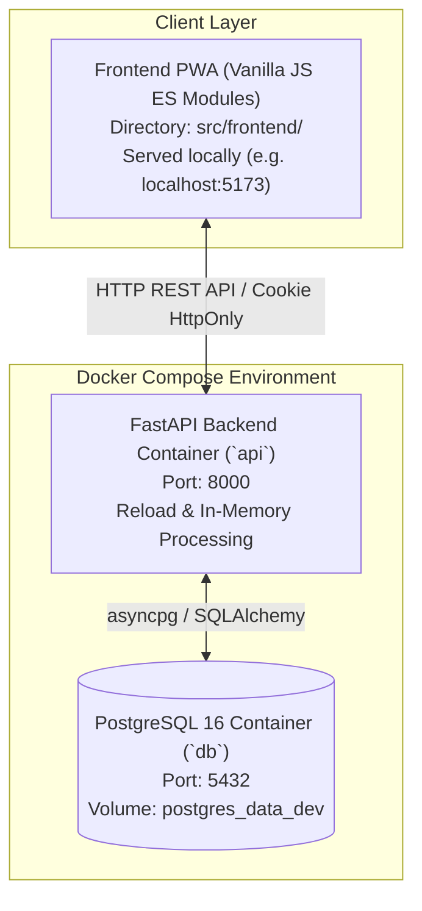
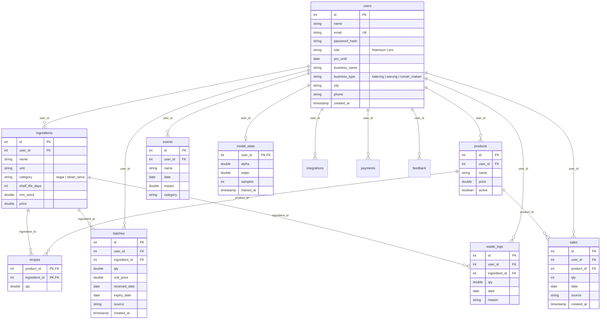

# Technical Requirement Document (TRD)
# StockWise Backend Modernization: FastAPI, PostgreSQL, Docker & Google Cloud Services

---

## Informasi Dokumen
* **Nama Dokumen:** Technical Requirement Document (TRD)
* **Produk:** StockWise Backend Modernization & Cloud Migration
* **Versi Dokumen:** 1.0.0
* **Status:** Final Technical Architecture & Specifications
* **Target Stack:** 
  * **Backend:** Python 3.11 / FastAPI / SQLAlchemy 2.0 (Asyncio) / Pydantic v2 / Asyncpg / Alembic *(usulan, perlu dikonfirmasi tim — alasan: ekosistem ilmiah Python ideal untuk komputasi analitik time-series & simulasi FEFO)*
  * **Database:** PostgreSQL 16 (container Docker lokal)
  * **Container & Runtime:** Docker / Docker Compose
  * **Frontend:** Vanilla JS (ES Modules) SPA / Mobile-First PWA (isi `public/` dipindahkan ke `src/frontend/`) *(sesuai makalah & prototipe eksisting)*

---

## 1. Pendahuluan & Tujuan Modernisasi

### 1.1 Latar Belakang Teknis
Aplikasi StockWise saat ini beroperasi menggunakan prototipe monolitik berbasis **Node.js (Express 5)** dengan basis data file lokal **SQLite (`node:sqlite`)**. Meskipun ringan untuk pembuktian konsep awal (MVP), arsitektur ini memiliki beberapa keterbatasan mendasar untuk tahap *production scale*:
1. **Keterbatasan SQLite Single-File:** Tidak dirancang untuk konkurensi tulis multi-tenant yang tinggi, sulit di-scale secara horizontal, dan berisiko kehilangan data pada platform container *stateless* (seperti Cloud Run) jika tanpa persistent volume.
2. **Kebutuhan Komputasi Analitik:** Algoritma peramalan *time-series*, evaluasi WAPE, dan simulasi inventaris FEFO 60 hari lebih modular, cepat, dan ekstensibel jika diimplementasikan menggunakan ekosistem komputasi ilmiah **Python**.
3. **Penyelarasan Infrastruktur Cloud:** Aplikasi membutuhkan arsitektur *cloud-native* berstandar enterprise dengan isolasi container Docker, manajemen rahasia terpusat, dan basis data terkelola dengan replikasi otomatis.

### 1.2 Tujuan Dokumen
Dokumen ini mendefinisikan kebutuhan teknis, arsitektur sistem, skema basis data, spesifikasi API, dan panduan transisi untuk **merombak total backend ke FastAPI**, dengan struktur proyek modular (Bagian 4), sementara antarmuka pengguna (**frontend Vanilla JS / PWA**) tetap dipertahankan dan dipindahkan ke dalam direktori `src/frontend/`. Struktur data pada respons API dipertahankan; penyesuaian frontend dibatasi pada `api.js` (Bagian 6.3).

---

## 2. Keputusan Arsitektur Database: Mandat Mutlak PostgreSQL (Google Cloud SQL)

### 2.1 Ketetapan Arsitektur Resmi
> **STATUS KEPUTUSAN: FINAL & MANDATORI**  
> Sistem backend StockWise **100% menggunakan PostgreSQL 16 (Google Cloud SQL for PostgreSQL)** sebagai satu-satunya *Primary Transactional & Analytical Database*.

### 2.2 Justifikasi Teknis & Keunggulan PostgreSQL untuk StockWise

1. **Integritas Relasional Resep (Bill of Materials / BOM):**
   * Resep menu adalah hubungan Many-to-Many (`recipes`) antara katalog menu (`products`) dan bahan mentah (`ingredients`).
   * PostgreSQL menyediakan penegakan integritas data yang kokoh melalui *Foreign Key Constraints* dan `ON DELETE CASCADE`, memastikan tidak terjadi anomali data yatim (*orphaned data*) saat bahan atau menu diperbarui/dihapus.
2. **Kueri Analitik & Time-Series 120 Hari Berkecepatan Tinggi:**
   * Algoritma peramalan StockWise membutuhkan pemrosesan data penjualan historis 56–120 hari ke belakang.
   * PostgreSQL memiliki kemampuan native agregasi tingkat lanjut (`SUM`, `AVG`, `GROUP BY product_id, date`), fungsi jendela (*rolling window* untuk faktor hari dalam seminggu), serta pengindeksan B-Tree yang mampu mengeksekusi kueri time-series dalam orde milidetik langsung di level database.
3. **Simulasi Inventaris Kronologis (FEFO):**
   * Pengambilan stok batch bahan baku wajib diurutkan berdasarkan tanggal kedaluwarsa terdekat (`ORDER BY expiry_date ASC, id ASC`).
   * PostgreSQL mendukung indeks komposit `(user_id, ingredient_id, expiry_date)` yang membuat operasi pencarian dan pemotongan batch FEFO (*First-Expired, First-Out*) sangat optimal untuk proses iterasi simulasi 60 hari ke depan.
4. **Konsistensi Transaksi Mutasi Stok (ACID):**
   * Mutasi inventaris melibatkan banyak tabel secara bersamaan (pencatatan penjualan $\rightarrow$ pengurangan stok bahan via resep $\rightarrow$ pencatatan sisa batch $\rightarrow$ pencatatan waste).
   * Transaksi ACID penuh (`BEGIN ... COMMIT / ROLLBACK`) pada PostgreSQL menjamin mutasi stok selalu konsisten, bebas dari *race condition*, dan data tidak pernah korup.
5. **Dukungan Ekosistem Modern Python:**
   * Didukung penuh oleh ekosistem Python modern: **SQLAlchemy 2.0 (Asyncio)** untuk ORM relasional, driver berperforma tinggi **Asyncpg** untuk koneksi asinkron tanpa blocking, dan **Alembic** untuk versioning skema migrasi database.
6. **Efisiensi Biaya & Skalabilitas Cloud Terkelola:**
   * Google Cloud SQL for PostgreSQL menyediakan fitur *high availability*, *automated backup*, dan *point-in-time recovery*. Model biaya berbasis kapasitas compute/storage memberikan tagihan bulanan yang stabil dan terprediksi untuk operasional analitik harian.

### 2.3 Spesifikasi Standar Implementasi PostgreSQL
1. **Database Engine:** PostgreSQL 16 Enterprise Edition pada Google Cloud SQL.
2. **Konektivitas Cloud:** Cloud Run terhubung ke Cloud SQL via **Cloud SQL Auth Proxy** (menggunakan Unix Domain Socket, tanpa eksposur IP publik).
3. **Database Driver & Pooling di FastAPI:**
   * Driver: `asyncpg` (Asynchronous PostgreSQL client untuk Python).
   * Engine: `create_async_engine("postgresql+asyncpg://...", pool_size=20, max_overflow=10, pool_pre_ping=True)`.
4. **Manajemen Migrasi:** Seluruh DDL dikelola menggunakan skrip revisi **Alembic** (`alembic upgrade head`).
5. **Konvensi Skema & Indeks Komposit:** Relasi ketat dengan deklarasi *Foreign Keys*, indeks teroptimasi untuk `(user_id, date)` dan `(user_id, ingredient_id, expiry_date)`, serta `CASCADE` delete untuk isolasi data pengguna yang bersih.

---

## 3. Arsitektur Sistem (Docker Lokal)

Arsitektur StockWise untuk kebutuhan tugas ini disederhanakan menjadi lingkungan mandiri berbasis Docker lokal tanpa ketergantungan pada layanan cloud berbayar.



### 3.1 Komponen Arsitektur Lokal
1. **Frontend PWA (`src/frontend/`):** Antarmuka pengguna berbasis Vanilla JS (ES Modules) yang disajikan menggunakan server statis lokal sederhana (misalnya port 5173).
2. **Backend FastAPI Container (`api`):** Menjalankan aplikasi web REST API Python 3.11 secara asinkron dengan fitur *hot-reload*. Seluruh pemrosesan, termasuk penguraian berkas impor transaksi Excel, diproses langsung di memori (*in-memory*) tanpa memerlukan layanan *object storage*.
3. **Database PostgreSQL 16 Container (`db`):** Menyimpan seluruh data relasional transaksional dan analitik pada container Docker lokal dengan *volume* persisten (`postgres_data_dev`). Migrasi skema database dijalankan melalui perintah Alembic sebelum server API aktif.

*(rencana deploy lanjutan, tidak dikerjakan pada versi tugas: Cloud Run dan Cloud SQL)*: Pada tahap pengembangan lanjutan di luar lingkup tugas kuliah ini, backend container dapat dideploy ke **Google Cloud Run** (*serverless container*) dan basis data dialihkan ke instance terkelola **Google Cloud SQL for PostgreSQL 16** untuk kebutuhan keandalan skala produksi dan automated backup.

### 3.2 Autentikasi (Email & Password, Dikelola Backend)
Autentikasi dikelola mandiri oleh backend FastAPI dengan data pengguna di PostgreSQL:
1. **Registrasi & login:** email dan kata sandi diverifikasi terhadap tabel `users`; email unik dan tidak peka huruf besar/kecil.
2. **Penyimpanan kata sandi:** hanya `password_hash` (bcrypt via `passlib`); kata sandi asli tidak pernah disimpan atau dicatat di log.
3. **Sesi:** setelah login, backend menerbitkan JWT (`app/lib/jwt_utils.py`) yang dikirim melalui cookie `HttpOnly` (`SameSite=Lax`). Masa berlaku token ditetapkan secara tegas:
   * **Access token:** 15 menit (`Max-Age=900` detik) untuk otorisasi request reguler. Access token yang kedaluwarsa diperbarui melalui refresh token di endpoint `/api/v1/auth/refresh` tanpa mengharuskan pengguna login ulang.
   * **Refresh token:** 7 hari (`Max-Age=604800` detik) untuk memperbarui access token.
   Nilai `Max-Age` cookie disamakan persis dengan masa berlaku masing-masing token.
4. **Penyimpanan kunci:** `JWT_SECRET` dikonfigurasi melalui *environment variable* (`development.env`), bukan disimpan di kode sumber.
5. **Perlindungan brute-force & sesi:** proteksi `rate_limit` (in-memory) dengan batas 5 request per 1 menit per alamat IP pada login dan registrasi, serta 60 request per 1 menit per pengguna (atau per IP jika anonim) pada endpoint lainnya. Saat batas terlampaui, sistem mengembalikan HTTP 429 dengan header `Retry-After` (dalam detik). Cookie sesi memakai atribut `HttpOnly` dan `SameSite=Lax`.
6. **Otorisasi:** `get_current_user` di `api/depedencies.py` membaca token, memuat pengguna, dan membatasi semua query dengan `user_id`; guard paket Pro untuk fitur sinkronisasi API dan forecast 14/30 hari.

---

## 4. Struktur Proyek

Repositori StockWise memakai tiga folder utama di root (`deploy/`, `docs/`, `src/`), backend berpola *vertical slice* per domain (`views.py`, `schema.py`, `repository.py`, `use_cases.py`), dan frontend di `src/frontend/`.

### 4.1 Ringkasan Peran Direktori

| Lokasi | Peran | Isi di StockWise |
|---|---|---|
| `deploy/compose/`, `deploy/docker/` | Infrastruktur per environment | Konfigurasi runtime Docker lokal (`dev`) |
| `src/frontend/` | Aplikasi frontend | Isi folder `public/` StockWise saat ini dipindahkan ke sini |
| `src/backend/app/api/<domain>/` | Satu folder per fitur | `auth`, `user`, `ingredient`, `product`, `batch`, `sale`, `waste_log`, `event`, `forecast`, `recommendation`, `dashboard`, `evaluation`, `subscription`, `integration`, `feedback`, `health` |
| `src/backend/app/models/*_model.py` | ORM SQLAlchemy | Satu model per tabel (lihat Bagian 5) |
| `src/backend/db_migrations/` | Alembic | Migrasi skema PostgreSQL |
| `src/backend/tests/{api,unit}/` | Pytest | Tes API dan tes unit |
| `server/` (Node.js lama) | — | Dihapus setelah backend FastAPI setara |

### 4.2 Struktur Direktori Target

```text
StockWise/
├── .gitignore
├── README.md
├── deploy/
│   ├── compose/
│   │   └── docker-compose.dev.yml
│   └── docker/
│       ├── backend.dev.Dockerfile
│       └── entrypoints/
│           └── api.sh
├── docs/
│   ├── PRD.md
│   └── TRD.md
└── src/
    ├── frontend/                          # Isi public/ StockWise dipindahkan ke sini
    │   ├── index.html
    │   ├── manifest.webmanifest
    │   ├── css/
    │   │   └── style.css
    │   ├── img/
    │   │   └── logo.png
    │   └── js/
    │       ├── app.js
    │       ├── api.js
    │       ├── ui.js
    │       └── pages/                     # akun, auth, bahan, dashboard, evaluasi, event,
    │                                      # forecast, import, langganan, menu, onboarding,
    │                                      # penjualan, rekomendasi, riwayat
    └── backend/
        ├── pyproject.toml
        ├── alembic.ini
        ├── app/
        │   ├── main.py                    # FastAPI app, middleware, exception handler, router
        │   ├── migrate.py                 # Eksekusi migrasi database Alembic
        │   ├── settings.py                # Pydantic BaseSettings
        │   ├── api/
        │   │   ├── main.py                # api_router: include_router tiap domain
        │   │   ├── depedencies.py         # get_db, get_current_user, guard paket Pro
        │   │   ├── standard_response.py   # Envelope response standar
        │   │   ├── auth/                  # UC-01
        │   │   │   ├── views.py
        │   │   │   ├── schema.py
        │   │   │   ├── repository.py
        │   │   │   └── use_cases.py
        │   │   ├── user/                  # UC-12 profil, hapus akun
        │   │   ├── ingredient/            # UC-02 bahan baku
        │   │   ├── product/               # UC-02 menu & resep
        │   │   ├── batch/                 # UC-03 stok masuk (FEFO)
        │   │   ├── sale/                  # UC-03, UC-04, UC-10 penjualan, impor Excel, riwayat
        │   │   ├── waste_log/             # UC-03 bahan terbuang
        │   │   ├── event/                 # hari khusus & multiplier
        │   │   ├── forecast/              # UC-05, UC-08
        │   │   ├── recommendation/        # UC-06, UC-07
        │   │   ├── dashboard/             # UC-09
        │   │   ├── evaluation/            # akurasi WAPE & retrain
        │   │   ├── subscription/          # UC-11 (simulasi: ubah status paket)
        │   │   ├── integration/           # UC-13 (simulasi: mock data provider)
        │   │   ├── feedback/              # UC-12 (simulasi: form simpan teks)
        │   │   │                          # (tiap folder domain berisi views.py, schema.py,
        │   │   │                          #  repository.py, use_cases.py seperti auth/)
        │   │   ├── health/
        │   │   │   ├── views.py
        │   │   │   └── schema.py
        │   │   └── exceptions/
        │   │       ├── exceptions.py          # CustomException dan seluruh domain exceptions
        │   │       └── handlers.py            # Global exception handlers & setup
        │   ├── config/
        │   │   └── env/
        │   │       └── env.example        # salin ke development.env
        │   ├── connections/
        │   │   └── postgres.py            # Async engine & session (PostgreSQL)
        │   ├── lib/
        │   │   ├── jwt_utils.py
        │   │   ├── forecast_math.py       # Exponential smoothing, faktor hari/event, WAPE
        │   │   └── fefo.py                # Inventory FEFO & simulasi waste
        │   ├── middleware/
        │   │   ├── cors.py
        │   │   ├── rate_limit.py
        │   │   ├── security_headers.py
        │   │   └── request_id.py
        │   └── models/
        │       ├── __init__.py
        │       ├── user_model.py
        │       ├── ingredient_model.py
        │       ├── product_model.py
        │       ├── recipe_model.py
        │       ├── batch_model.py
        │       ├── sale_model.py
        │       ├── waste_log_model.py
        │       ├── event_model.py
        │       ├── model_state_model.py
        │       ├── integration_model.py
        │       ├── payment_model.py
        │       └── feedback_model.py
        ├── db_migrations/
        │   ├── README
        │   ├── env.py
        │   ├── script.py.mako
        │   └── versions/
        └── tests/
            ├── __init__.py
            ├── conftest.py
            ├── api/
            │   ├── __init__.py
            │   ├── auth/                  # test_auth_api.py
            │   └── forecast/              # test_forecast_api.py (domain inti)
            └── unit/
                ├── __init__.py
                └── lib/                   # test_forecast_math.py, test_fefo.py
```

### 4.3 Konvensi Struktur

1. **Satu folder per domain** di `app/api/`, berisi empat file dengan tanggung jawab tetap: `views.py` (router FastAPI), `schema.py` (DTO Pydantic), `repository.py` (query SQLAlchemy async), `use_cases.py` (logika bisnis).
2. **`api/main.py`** menjadi satu-satunya tempat `include_router` semua domain; `app/main.py` memasang middleware, exception handler, dan `health` di prefix `/api/v1`.
3. **Penamaan & Exceptions:** folder domain berbentuk tunggal snake_case, model berakhiran `_model.py`, dan seluruh custom domain exception dikelompokkan ke dalam `api/exceptions/exceptions.py` dengan handler terpusat di `handlers.py`.
4. **Konfigurasi Environment:** `development.env` dibuat dari `env.example` dan dimuat lewat `env_file` pada Docker Compose.
5. **Migrasi Database:** Dijalankan dengan perintah Alembic (`alembic upgrade head`) sebelum kontainer API start pada alur setup development.
6. **Logika algoritma** (forecast, FEFO) ditaruh di `app/lib/` agar dapat diuji unit tanpa database; `use_cases.py` hanya memanggilnya.
7. **Prefix API:** seluruh router berada di bawah `/api/v1`. `src/frontend/js/api.js` harus menyesuaikan base path dari `/api` menjadi `/api/v1`.

---

## 5. Skema Basis Data Relasional (PostgreSQL)



### 5.1 Spesifikasi Tipe Data & Indeks PostgreSQL
1. **Tipe Data Optimal:**
   * Kuantitas pecahan dan takaran resep menggunakan `DOUBLE PRECISION` atau `NUMERIC(12, 4)`.
   * Kolom tanggal transaksi menggunakan tipe native `DATE`.
   * Kategori menggunakan `VARCHAR(20)` dengan `CHECK CONSTRAINT` (`segar`, `tahan_lama`).
2. **Indeks Strategis (Index Optimization):**
   * `idx_sales_user_date ON sales(user_id, date)`: Mempercepat kueri riwayat 120 hari untuk model forecasting.
   * `idx_batches_user_expiry ON batches(user_id, ingredient_id, expiry_date)`: Mempercepat pemilihan batch paling awal kedaluwarsa (**FEFO**).
   * `idx_waste_user_date ON waste_logs(user_id, date)`: Mempercepat agregasi laporan limbah berkala.
   * `idx_events_user_date ON events(user_id, date)`: Mempercepat pencarian event hari khusus.

---

## 6. Kontrak API & Standard Response

Seluruh endpoint backend mengembalikan satu format respons standar (*standard response envelope*), baik pada saat request berhasil maupun gagal. Format ini mengacu pada implementasi `src/backend/app/api/standard_response.py` dan diterapkan secara konsisten di seluruh `views.py` serta *exception handler*.

### 6.1 Format Standard Response

#### 6.1.1 Definisi Pydantic Schema (`standard_response.py`)

```python
from typing import Generic, TypeVar, Optional
from pydantic import BaseModel

T = TypeVar("T")


class ErrorDetail(BaseModel):
    code: str
    message: str
    request_id: Optional[str] = None


class StandardResponse(BaseModel, Generic[T]):
    success: bool
    data: Optional[T] = None
    error: Optional[ErrorDetail] = None


def success_response(data):
    return {
        "success": True,
        "data": data,
        "error": None,
    }


def error_response(code: str, message: str, request_id: str | None = None):
    return {
        "success": False,
        "data": None,
        "error": {
            "code": code,
            "message": message,
            "request_id": request_id,
        },
    }
```

#### 6.1.2 Struktur Envelope Respons

| Field | Tipe | Keterangan |
|---|---|---|
| `success` | `boolean` | `true` jika request berhasil diproses, `false` jika terjadi error. |
| `data` | `T` / `null` | Payload hasil request jika berhasil. Bernilai `null` jika request gagal atau untuk operasi yang tidak menghasilkan objek (mis. `DELETE`, `logout`). |
| `error` | `ErrorDetail` / `null` | Objek detail error jika gagal, bernilai `null` jika request berhasil. |
| `error.code` | `string` | Kode error mesin yang stabil (mis. `VALIDATION_ERROR`, `IngredientNotFoundException`). |
| `error.message` | `string` | Pesan error deskriptif yang ramah pengguna dalam Bahasa Indonesia. |
| `error.request_id` | `string` / `null` | ID pelacakan unik dari middleware `request_id` (`X-Request-ID`) untuk penelusuran log server. |

#### 6.1.3 Pola Respons Berhasil (Success Envelope)

Status HTTP: `200 OK` (atau `201 Created` untuk pembuatan data baru).

```json
{
  "success": true,
  "data": {
    "id": 1,
    "name": "Daging Ayam Broiler",
    "unit": "kg",
    "category": "segar",
    "shelf_life_days": 3
  },
  "error": null
}
```

#### 6.1.4 Pola Respons Gagal (Error Envelope)

Status HTTP: Sesuai kategori error (`400`, `401`, `403`, `404`, `409`, `422`, `500`).

```json
{
  "success": false,
  "data": null,
  "error": {
    "code": "IngredientNotFoundException",
    "message": "Bahan baku dengan ID tersebut tidak ditemukan",
    "request_id": "9f1c2b7e-4a63-4d0e-8a51-0c6d1e2f3a44"
  }
}
```

#### 6.1.5 Matriks Penanganan Error Global

| Sumber Error | HTTP Status | Nilai `error.code` | Nilai `error.message` |
|---|---|---|---|
| `CustomException` (Bisnis Domain) | `400` / `401` / `403` / `404` / `409` / `422` | Nama kelas exception (mis. `EmailAlreadyRegisteredException`) | Pesan spesifik dari use case |
| `HTTPException` (FastAPI/Starlette) | Status aslinya | `HTTP_EXCEPTION` | Detail exception |
| Method Not Allowed (405) | `404` | `NOT_FOUND` | `Endpoint tidak ditemukan` |
| `RequestValidationError` | `422` | `VALIDATION_ERROR` | `<field>: <pesan error validasi Pydantic>` |
| Unhandled Server Exception | `500` | `INTERNAL_SERVER_ERROR` | `Terjadi kesalahan internal pada server` |

---

### 6.2 Matriks Kontrak API per Domain (API Contracts)

Berikut adalah kontrak presisi untuk seluruh endpoint StockWise, mencakup format Request, Success Response, dan Error Response standar:

---

#### 6.2.1 Auth Domain (`/api/v1/auth`) — UC-01

##### 1. Register Akun Baru
* **Endpoint:** `POST /api/v1/auth/register`
* **Auth:** Tidak (Publik)
* **Request Body:**
  ```json
  {
    "name": "Budi Santoso",
    "email": "budi@kateringberkah.com",
    "password": "PasswordAman123!",
    "business_name": "Katering Berkah",
    "business_type": "katering",
    "city": "Surabaya",
    "phone": "081234567890"
  }
  ```
* **Success Response (201 Created):**
  ```json
  {
    "success": true,
    "data": {
      "id": 1,
      "name": "Budi Santoso",
      "email": "budi@kateringberkah.com",
      "role": "freemium",
      "pro_until": null,
      "business_name": "Katering Berkah",
      "business_type": "katering",
      "city": "Surabaya",
      "phone": "081234567890",
      "created_at": "2026-10-29T10:00:00Z"
    },
    "error": null
  }
  ```
* **Error Response (409 Conflict):**
  ```json
  {
    "success": false,
    "data": null,
    "error": {
      "code": "EmailAlreadyRegisteredException",
      "message": "Email budi@kateringberkah.com sudah terdaftar di sistem",
      "request_id": "req-auth-01"
    }
  }
  ```
* **Error Response (429 Too Many Requests):** *(Batas 5 request/menit per IP; Header: `Retry-After: 60`)*
  ```json
  {
    "success": false,
    "data": null,
    "error": {
      "code": "RateLimitExceededException",
      "message": "Terlalu banyak permintaan pendaftaran dari alamat IP ini. Silakan coba lagi setelah 60 detik.",
      "request_id": "req-auth-01-limit"
    }
  }
  ```

##### 2. Login
* **Endpoint:** `POST /api/v1/auth/login`
* **Auth:** Tidak (Publik)
* **Request Body:**
  ```json
  {
    "email": "budi@kateringberkah.com",
    "password": "PasswordAman123!"
  }
  ```
* **Success Response (200 OK):** *(Token access 15 menit & refresh 7 hari dikirim otomatis via cookie `HttpOnly`)*
  ```json
  {
    "success": true,
    "data": {
      "id": 1,
      "name": "Budi Santoso",
      "email": "budi@kateringberkah.com",
      "role": "freemium",
      "business_name": "Katering Berkah",
      "business_type": "katering"
    },
    "error": null
  }
  ```
* **Error Response (401 Unauthorized):**
  ```json
  {
    "success": false,
    "data": null,
    "error": {
      "code": "InvalidCredentialsException",
      "message": "Email atau kata sandi yang Anda masukkan salah",
      "request_id": "req-auth-02"
    }
  }
  ```
* **Error Response (429 Too Many Requests):** *(Batas 5 request/menit per IP; Header: `Retry-After: 60`)*
  ```json
  {
    "success": false,
    "data": null,
    "error": {
      "code": "RateLimitExceededException",
      "message": "Terlalu banyak percobaan masuk dari alamat IP ini. Silakan coba lagi setelah 60 detik.",
      "request_id": "req-auth-02-limit"
    }
  }
  ```

##### 3. Logout
* **Endpoint:** `POST /api/v1/auth/logout`
* **Auth:** Ya (Cookie HttpOnly)
* **Success Response (200 OK):**
  ```json
  {
    "success": true,
    "data": null,
    "error": null
  }
  ```

##### 4. Dapatkan Profil Login (`me`)
* **Endpoint:** `GET /api/v1/auth/me`
* **Auth:** Ya
* **Success Response (200 OK):**
  ```json
  {
    "success": true,
    "data": {
      "id": 1,
      "name": "Budi Santoso",
      "email": "budi@kateringberkah.com",
      "role": "freemium",
      "pro_until": null,
      "business_name": "Katering Berkah",
      "business_type": "katering",
      "city": "Surabaya",
      "phone": "081234567890"
    },
    "error": null
  }
  ```
* **Error Response (401 Unauthorized):**
  ```json
  {
    "success": false,
    "data": null,
    "error": {
      "code": "NotAuthenticatedException",
      "message": "Sesi Anda telah berakhir, silakan login kembali",
      "request_id": "req-auth-04"
    }
  }
  ```

##### 5. Refresh Token
* **Endpoint:** `POST /api/v1/auth/refresh`
* **Auth:** Ya (Cookie HttpOnly `refresh_token`)
* **Header Respons:** `Set-Cookie: access_token=...; Max-Age=900; Path=/; HttpOnly; SameSite=Lax`
* **Success Response (200 OK):**
  ```json
  {
    "success": true,
    "data": {
      "message": "Access token berhasil diperbarui"
    },
    "error": null
  }
  ```
* **Error Response (401 Unauthorized):**
  ```json
  {
    "success": false,
    "data": null,
    "error": {
      "code": "InvalidRefreshTokenException",
      "message": "Sesi refresh token tidak valid atau telah kedaluwarsa, silakan login kembali",
      "request_id": "req-auth-05"
    }
  }
  ```
* **Error Response (429 Too Many Requests):** *(Batas 60 request/menit; Header: `Retry-After: 15`)*
  ```json
  {
    "success": false,
    "data": null,
    "error": {
      "code": "RateLimitExceededException",
      "message": "Batas permintaan per menit terlampaui. Silakan tunggu beberapa saat.",
      "request_id": "req-auth-05-limit"
    }
  }
  ```

---

#### 6.2.2 User Domain (`/api/v1/users`) — UC-12

##### 1. Perbarui Profil Pengguna
* **Endpoint:** `PATCH /api/v1/users/me`
* **Auth:** Ya
* **Request Body:**
  ```json
  {
    "name": "Budi Santoso Update",
    "business_name": "Katering Berkah Jaya",
    "city": "Sidoarjo"
  }
  ```
* **Success Response (200 OK):**
  ```json
  {
    "success": true,
    "data": {
      "id": 1,
      "name": "Budi Santoso Update",
      "email": "budi@kateringberkah.com",
      "business_name": "Katering Berkah Jaya",
      "city": "Sidoarjo"
    },
    "error": null
  }
  ```

##### 2. Ganti Kata Sandi
* **Endpoint:** `PATCH /api/v1/users/me/password`
* **Auth:** Ya
* **Request Body:**
  ```json
  {
    "current_password": "PasswordLama123!",
    "new_password": "PasswordBaru456!"
  }
  ```
* **Success Response (200 OK):**
  ```json
  {
    "success": true,
    "data": null,
    "error": null
  }
  ```
* **Error Response (400 Bad Request):**
  ```json
  {
    "success": false,
    "data": null,
    "error": {
      "code": "InvalidCurrentPasswordException",
      "message": "Kata sandi saat ini tidak cocok",
      "request_id": "req-user-02"
    }
  }
  ```

##### 3. Hapus Akun Pengguna
* **Endpoint:** `DELETE /api/v1/users/me`
* **Auth:** Ya
* **Request Body:**
  ```json
  {
    "password": "PasswordBaru456!"
  }
  ```
* **Success Response (200 OK):**
  ```json
  {
    "success": true,
    "data": null,
    "error": null
  }
  ```

---

#### 6.2.3 Ingredient Domain (`/api/v1/ingredients`) — UC-02

##### 1. Dapatkan Daftar Bahan Baku
* **Endpoint:** `GET /api/v1/ingredients?limit=10&offset=0&category=segar`
* **Auth:** Ya
* **Success Response (200 OK):**
  ```json
  {
    "success": true,
    "data": {
      "items": [
        {
          "id": 7,
          "name": "Daging Ayam Broiler",
          "unit": "kg",
          "category": "segar",
          "shelf_life_days": 3,
          "min_stock": 5.0,
          "price": 35000,
          "stock_now": 12.5
        }
      ],
      "total": 1,
      "limit": 10,
      "offset": 0
    },
    "error": null
  }
  ```

##### 2. Dapatkan Detail Bahan Baku
* **Endpoint:** `GET /api/v1/ingredients/{id}`
* **Auth:** Ya
* **Success Response (200 OK):**
  ```json
  {
    "success": true,
    "data": {
      "id": 7,
      "name": "Daging Ayam Broiler",
      "unit": "kg",
      "category": "segar",
      "shelf_life_days": 3,
      "min_stock": 5.0,
      "price": 35000,
      "stock_now": 12.5
    },
    "error": null
  }
  ```
* **Error Response (404 Not Found):**
  ```json
  {
    "success": false,
    "data": null,
    "error": {
      "code": "IngredientNotFoundException",
      "message": "Bahan baku tidak ditemukan",
      "request_id": "req-ing-02"
    }
  }
  ```

##### 3. Tambah Bahan Baku Baru
* **Endpoint:** `POST /api/v1/ingredients`
* **Auth:** Ya
* **Request Body:**
  ```json
  {
    "name": "Beras Putih Premium",
    "unit": "kg",
    "category": "tahan_lama",
    "shelf_life_days": 90,
    "min_stock": 25.0,
    "price": 14000
  }
  ```
* **Success Response (201 Created):**
  ```json
  {
    "success": true,
    "data": {
      "id": 8,
      "name": "Beras Putih Premium",
      "unit": "kg",
      "category": "tahan_lama",
      "shelf_life_days": 90,
      "min_stock": 25.0,
      "price": 14000,
      "stock_now": 0.0
    },
    "error": null
  }
  ```
* **Error Response (422 Unprocessable Entity):**
  ```json
  {
    "success": false,
    "data": null,
    "error": {
      "code": "VALIDATION_ERROR",
      "message": "shelf_life_days: Masa simpan harus minimal 1 hari",
      "request_id": "req-ing-03"
    }
  }
  ```

##### 4. Perbarui Bahan Baku
* **Endpoint:** `PATCH /api/v1/ingredients/{id}`
* **Auth:** Ya
* **Request Body:**
  ```json
  {
    "price": 14500,
    "min_stock": 30.0
  }
  ```
* **Success Response (200 OK):**
  ```json
  {
    "success": true,
    "data": {
      "id": 8,
      "name": "Beras Putih Premium",
      "unit": "kg",
      "category": "tahan_lama",
      "shelf_life_days": 90,
      "min_stock": 30.0,
      "price": 14500
    },
    "error": null
  }
  ```

##### 5. Hapus Bahan Baku
* **Endpoint:** `DELETE /api/v1/ingredients/{id}`
* **Auth:** Ya
* **Success Response (200 OK):**
  ```json
  {
    "success": true,
    "data": null,
    "error": null
  }
  ```

---

#### 6.2.4 Product & Resep Domain (`/api/v1/products`) — UC-02

##### 1. Dapatkan Daftar Menu & Resep
* **Endpoint:** `GET /api/v1/products?limit=10&offset=0&active=true`
* **Auth:** Ya
* **Success Response (200 OK):**
  ```json
  {
    "success": true,
    "data": {
      "items": [
        {
          "id": 1,
          "name": "Paket Nasi Ayam Goreng",
          "price": 25000,
          "active": true,
          "recipe": [
            { "ingredient_id": 7, "ingredient_name": "Daging Ayam Broiler", "qty": 0.2, "unit": "kg" },
            { "ingredient_id": 8, "ingredient_name": "Beras Putih Premium", "qty": 0.15, "unit": "kg" }
          ]
        }
      ],
      "total": 1,
      "limit": 10,
      "offset": 0
    },
    "error": null
  }
  ```

##### 2. Tambah Menu & Resep Baru
* **Endpoint:** `POST /api/v1/products`
* **Auth:** Ya
* **Request Body:**
  ```json
  {
    "name": "Paket Ayam Bakar Madu",
    "price": 28000,
    "recipe": [
      { "ingredient_id": 7, "qty": 0.25 },
      { "ingredient_id": 8, "qty": 0.15 }
    ]
  }
  ```
* **Success Response (201 Created):**
  ```json
  {
    "success": true,
    "data": {
      "id": 2,
      "name": "Paket Ayam Bakar Madu",
      "price": 28000,
      "active": true,
      "recipe": [
        { "ingredient_id": 7, "qty": 0.25 },
        { "ingredient_id": 8, "qty": 0.15 }
      ]
    },
    "error": null
  }
  ```
* **Error Response (404 Not Found):**
  ```json
  {
    "success": false,
    "data": null,
    "error": {
      "code": "IngredientNotFoundException",
      "message": "Bahan baku pada komposisi resep tidak ditemukan",
      "request_id": "req-prod-02"
    }
  }
  ```

##### 3. Hapus Menu
* **Endpoint:** `DELETE /api/v1/products/{id}`
* **Auth:** Ya
* **Success Response (200 OK):**
  ```json
  {
    "success": true,
    "data": null,
    "error": null
  }
  ```

---

#### 6.2.5 Batch / Stok Masuk Domain (`/api/v1/batches`) — UC-03

##### 1. Dapatkan Daftar Batch Stok Aktif (FEFO)
* **Endpoint:** `GET /api/v1/batches?ingredient_id=7&active_only=true`
* **Auth:** Ya
* **Success Response (200 OK):**
  ```json
  {
    "success": true,
    "data": {
      "items": [
        {
          "id": 101,
          "ingredient_id": 7,
          "ingredient_name": "Daging Ayam Broiler",
          "qty": 5.0,
          "unit_price": 35000,
          "received_date": "2026-10-28",
          "expiry_date": "2026-10-31",
          "source": "manual"
        }
      ],
      "total": 1,
      "limit": 10,
      "offset": 0
    },
    "error": null
  }
  ```

##### 2. Catat Stok Masuk Manual
* **Endpoint:** `POST /api/v1/batches`
* **Auth:** Ya
* **Request Body:**
  ```json
  {
    "ingredient_id": 7,
    "qty": 15.0,
    "unit_price": 35000,
    "received_date": "2026-10-29",
    "expiry_date": "2026-11-01"
  }
  ```
* **Success Response (201 Created):**
  ```json
  {
    "success": true,
    "data": {
      "id": 102,
      "ingredient_id": 7,
      "qty": 15.0,
      "unit_price": 35000,
      "received_date": "2026-10-29",
      "expiry_date": "2026-11-01",
      "source": "manual",
      "created_at": "2026-10-29T10:15:00Z"
    },
    "error": null
  }
  ```

##### 3. Pembelian Massal dari Rekomendasi (*Mark as Purchased*)
* **Endpoint:** `POST /api/v1/batches/purchase`
* **Auth:** Ya
* **Request Body:**
  ```json
  {
    "items": [
      { "ingredient_id": 7, "qty": 15.0, "unit_price": 35000 }
    ]
  }
  ```
* **Success Response (201 Created):**
  ```json
  {
    "success": true,
    "data": {
      "created_count": 1,
      "batches": [
        {
          "id": 103,
          "ingredient_id": 7,
          "qty": 15.0,
          "expiry_date": "2026-11-01"
        }
      ]
    },
    "error": null
  }
  ```

---

#### 6.2.6 Waste Log Domain (`/api/v1/waste-logs`) — UC-03

##### 1. Catat Bahan Terbuang / Rusak
* **Endpoint:** `POST /api/v1/waste-logs`
* **Auth:** Ya
* **Request Body:**
  ```json
  {
    "ingredient_id": 7,
    "qty": 1.5,
    "date": "2026-10-29",
    "reason": "Kedaluwarsa karena melebihi masa simpan"
  }
  ```
* **Success Response (201 Created):**
  ```json
  {
    "success": true,
    "data": {
      "id": 501,
      "ingredient_id": 7,
      "qty": 1.5,
      "date": "2026-10-29",
      "reason": "Kedaluwarsa karena melebihi masa simpan"
    },
    "error": null
  }
  ```

---

#### 6.2.7 Sale Domain (`/api/v1/sales`) — UC-03, UC-04, UC-10

> **Catatan Kuota Freemium:** Batas kuota transaksi paket Freemium (misal: 500 transaksi/bulan) merupakan *(usulan, perlu dikonfirmasi tim)* karena makalah belum menetapkan batasan kuota numerik secara eksplisit.

##### 1. Catat Transaksi Penjualan Manual
* **Endpoint:** `POST /api/v1/sales`
* **Auth:** Ya
* **Request Body:**
  ```json
  {
    "date": "2026-10-29",
    "items": [
      { "product_id": 1, "qty": 40 }
    ],
    "source": "manual"
  }
  ```
* **Success Response (201 Created):**
  ```json
  {
    "success": true,
    "data": {
      "recorded_count": 1,
      "quota": {
        "used": 420,
        "limit": 500,
        "is_unlimited": false
      }
    },
    "error": null
  }
  ```
* **Error Response (403 Forbidden):**
  ```json
  {
    "success": false,
    "data": null,
    "error": {
      "code": "FreemiumQuotaExceededException",
      "message": "Batas transaksi bulanan paket Freemium (500 transaksi) telah tercapai. Silakan tingkatkan ke paket Pro.",
      "request_id": "req-sale-01"
    }
  }
  ```

##### 2. Impor Transaksi Penjualan (Excel/CSV Parser Browser)
* **Endpoint:** `POST /api/v1/sales/import`
* **Auth:** Ya
* **Request Body:**
  ```json
  {
    "rows": [
      { "date": "2026-10-25", "product": "Paket Nasi Ayam Goreng", "qty": 50 },
      { "date": "2026-10-26", "product": "Paket Nasi Ayam Goreng", "qty": 45 }
    ]
  }
  ```
* **Success Response (201 Created):**
  ```json
  {
    "success": true,
    "data": {
      "imported": 2,
      "skipped": 0,
      "errors": []
    },
    "error": null
  }
  ```
* **Error Response (422 Unprocessable Entity):**
  ```json
  {
    "success": false,
    "data": null,
    "error": {
      "code": "InvalidImportDataException",
      "message": "Format tanggal pada baris 5 tidak valid (harus YYYY-MM-DD)",
      "request_id": "req-sale-02"
    }
  }
  ```

---

#### 6.2.8 Event Domain (`/api/v1/events`)

##### 1. Catat Hari Khusus / Acara
* **Endpoint:** `POST /api/v1/events`
* **Auth:** Ya
* **Request Body:**
  ```json
  {
    "name": "Pesanan Katering Pernikahan",
    "date": "2026-11-05",
    "impact": 2.5,
    "category": "pesanan_besar"
  }
  ```
* **Success Response (201 Created):**
  ```json
  {
    "success": true,
    "data": {
      "id": 12,
      "name": "Pesanan Katering Pernikahan",
      "date": "2026-11-05",
      "impact": 2.5,
      "category": "pesanan_besar"
    },
    "error": null
  }
  ```

---

#### 6.2.9 Forecast Domain (`/api/v1/forecast`) — UC-05, UC-08

> **Catatan Riwayat & Horizon:** Syarat minimal 14 hari riwayat aktif sebelum forecast dapat dijalankan, serta pembatasan horizon Freemium (maksimal 7 hari) vs Pro (14 dan 30 hari), merupakan *(usulan, perlu dikonfirmasi tim)* karena makalah hanya menyebutkan kebutuhan riwayat "beberapa minggu" tanpa angka pasti.

##### 1. Dapatkan Hasil Peramalan Permintaan
* **Endpoint:** `GET /api/v1/forecast?days=7&view=bahan`
* **Auth:** Ya
* **Success Response (200 OK):**
  ```json
  {
    "success": true,
    "data": {
      "period_start": "2026-10-30",
      "period_end": "2026-11-05",
      "days_count": 7,
      "ingredients": [
        {
          "id": 7,
          "name": "Daging Ayam Broiler",
          "unit": "kg",
          "total_need": 140.0,
          "need_lo": 126.0,
          "need_hi": 154.0,
          "daily_needs": [
            { "date": "2026-10-30", "need": 20.0, "need_lo": 18.0, "need_hi": 22.0 }
          ]
        }
      ],
      "events": []
    },
    "error": null
  }
  ```
* **Error Response (403 Forbidden - Khusus Freemium yang meminta > 7 hari):**
  ```json
  {
    "success": false,
    "data": null,
    "error": {
      "code": "ProPlanRequiredException",
      "message": "Peramalan 14 dan 30 hari hanya tersedia pada paket Pro",
      "request_id": "req-fore-01"
    }
  }
  ```
* **Error Response (422 Unprocessable Entity - Data Belum Cukup):**
  ```json
  {
    "success": false,
    "data": null,
    "error": {
      "code": "InsufficientHistoryException",
      "message": "Riwayat transaksi penjualan belum mencukupi untuk melakukan peramalan (minimal 14 hari riwayat aktif)",
      "request_id": "req-fore-02"
    }
  }
  ```

---

#### 6.2.10 Recommendation Domain (`/api/v1/recommendations`) — UC-06, UC-07

##### 1. Dapatkan Rekomendasi Pembelian & Waste Risk Score
* **Endpoint:** `GET /api/v1/recommendations?status=beli`
* **Auth:** Ya
* **Success Response (200 OK):** *(Contoh sesuai perhitungan UC-06 di makalah)*
  ```json
  {
    "success": true,
    "data": {
      "date": "2026-10-29",
      "period_start": "2026-10-30",
      "items": [
        {
          "id": 7,
          "name": "Daging Ayam Broiler",
          "unit": "kg",
          "category": "segar",
          "horizon": 1,
          "period_label": "Besok, Jum, 30 Okt",
          "stock_now": 5.0,
          "stock_start": 5.0,
          "need": 20.0,
          "need_lo": 18.0,
          "need_hi": 22.0,
          "buy": 15.0,
          "buy_lo": 13.0,
          "buy_hi": 17.0,
          "buy_cost": 525000,
          "status": "beli",
          "risk": {
            "level": "rendah",
            "waste_qty": 0.5,
            "waste_value": 17500,
            "ratio": 0.025,
            "first_date": null,
            "safe_buy": 15.0,
            "message": null
          }
        }
      ]
    },
    "error": null
  }
  ```

---

#### 6.2.11 Dashboard Domain (`/api/v1/dashboard`) — UC-09

##### 1. Ringkasan Eksekutif Dashboard
* **Endpoint:** `GET /api/v1/dashboard`
* **Auth:** Ya
* **Success Response (200 OK):**
  ```json
  {
    "success": true,
    "data": {
      "date": "2026-10-29",
      "counts": {
        "products": 12,
        "ingredients": 34,
        "history_days": 45
      },
      "waste": {
        "current_month_cost": 150000,
        "previous_month_cost": 320000,
        "reduction_percentage": 53.1
      },
      "risk": {
        "high": 1,
        "medium": 3,
        "low": 30
      },
      "buy": {
        "items_to_buy": 4,
        "estimated_total_cost": 1250000
      },
      "portions": [
        { "product_id": 1, "product_name": "Paket Nasi Ayam Goreng", "remaining_portions": 25 }
      ]
    },
    "error": null
  }
  ```

---

#### 6.2.12 Evaluation Domain (`/api/v1/evaluation`)

##### 1. Evaluasi Akurasi Model & Metrik WAPE
* **Endpoint:** `GET /api/v1/evaluation`
* **Auth:** Ya
* **Success Response (200 OK):**
  ```json
  {
    "success": true,
    "data": {
      "accuracy": 87.5,
      "accuracy_prev": 82.1,
      "model": {
        "alpha": 0.2,
        "wape": 0.125,
        "samples": 90,
        "history_days": 90,
        "trained_at": "2026-10-29T02:00:00Z"
      },
      "products": [
        { "product_id": 1, "product_name": "Paket Nasi Ayam Goreng", "accuracy": 89.2, "bias": "over" }
      ]
    },
    "error": null
  }
  ```

##### 2. Pelatihan Ulang Parameter Model (Retrain)
* **Endpoint:** `POST /api/v1/evaluation/train`
* **Auth:** Ya
* **Success Response (200 OK):**
  ```json
  {
    "success": true,
    "data": {
      "trained": true,
      "optimal_alpha": 0.2,
      "wape": 0.125,
      "samples": 90
    },
    "error": null
  }
  ```

---

#### 6.2.13 Subscription Domain (`/api/v1/subscription`) — UC-11

> **Catatan (disimulasikan pada versi tugas):** Tombol upgrade Pro hanya mengubah status paket pengguna (`role` menjadi `pro` dan mengisi masa aktif `pro_until`), tanpa integrasi gateway pembayaran riil. Endpoint checkout langsung menyimulasikan transaksi lunas (`payment_simulation: true`).

##### 1. Dapatkan Status Langganan
* **Endpoint:** `GET /api/v1/subscription`
* **Auth:** Ya
* **Success Response (200 OK):**
  ```json
  {
    "success": true,
    "data": {
      "role": "freemium",
      "pro_until": null,
      "price_monthly": 100000,
      "methods": ["qris", "va_bca", "va_mandiri", "gopay"],
      "payments": []
    },
    "error": null
  }
  ```

##### 2. Peningkatan Paket ke Pro (Checkout)
* **Endpoint:** `POST /api/v1/subscription/checkout`
* **Auth:** Ya
* **Request Body:**
  ```json
  {
    "method": "qris",
    "months": 1
  }
  ```
* **Success Response (201 Created):**
  ```json
  {
    "success": true,
    "data": {
      "order_id": "SUB-20261029-001",
      "amount": 100000,
      "status": "active",
      "pro_until": "2026-11-29T23:59:59Z",
      "payment_simulation": true
    },
    "error": null
  }
  ```

##### 3. Batalkan Perpanjangan Paket Pro
* **Endpoint:** `POST /api/v1/subscription/cancel`
* **Auth:** Ya
* **Success Response (200 OK):**
  ```json
  {
    "success": true,
    "data": {
      "role": "freemium",
      "message": "Langganan Pro berhasil dibatalkan"
    },
    "error": null
  }
  ```

---

#### 6.2.14 Integration Domain (`/api/v1/integrations`) — UC-13 (Khusus Pro)

> **Catatan (disimulasikan pada versi tugas):** Sinkronisasi data transaksi dengan MokaPOS, GoFood, Grab, dan Shopee Partner memakai data contoh (*mock*), bukan koneksi API sungguhan ke server penyedia pihak ketiga. Endpoint sync membangkitkan data transaksi pesanan contoh ke tabel `sales` untuk simulasi otomatisasi operasional.

##### 1. Dapatkan Daftar Status Integrasi
* **Endpoint:** `GET /api/v1/integrations`
* **Auth:** Ya
* **Success Response (200 OK):**
  ```json
  {
    "success": true,
    "data": {
      "providers": [
        { "name": "mokapos", "label": "Moka POS", "connected": false, "last_sync": null },
        { "name": "gofood", "label": "GoFood (GoBiz)", "connected": true, "last_sync": "2026-10-29T08:00:00Z" },
        { "name": "grabfood", "label": "GrabFood (GrabMerchant)", "connected": false, "last_sync": null },
        { "name": "shopeefood", "label": "ShopeeFood (Shopee Partner)", "connected": false, "last_sync": null }
      ]
    },
    "error": null
  }
  ```

##### 2. Hubungkan Layanan Pihak Ketiga
* **Endpoint:** `POST /api/v1/integrations/{provider}/connect`
* **Auth:** Ya (Pro Guard)
* **Request Body:**
  ```json
  {
    "api_key": "mokapos_secret_key_12345"
  }
  ```
* **Success Response (201 Created):**
  ```json
  {
    "success": true,
    "data": {
      "provider": "mokapos",
      "connected": true,
      "connected_at": "2026-10-29T10:30:00Z"
    },
    "error": null
  }
  ```
* **Error Response (403 Forbidden):**
  ```json
  {
    "success": false,
    "data": null,
    "error": {
      "code": "ProPlanRequiredException",
      "message": "Sinkronisasi otomatis POS dan Food Delivery hanya tersedia untuk pengguna paket Pro",
      "request_id": "req-int-02"
    }
  }
  ```

##### 3. Jalankan Sinkronisasi Manual
* **Endpoint:** `POST /api/v1/integrations/{provider}/sync`
* **Auth:** Ya (Pro Guard)
* **Success Response (200 OK):**
  ```json
  {
    "success": true,
    "data": {
      "provider": "gofood",
      "synced_orders": 34,
      "last_sync": "2026-10-29T10:32:00Z"
    },
    "error": null
  }
  ```
* **Error Response (409 Conflict):**
  ```json
  {
    "success": false,
    "data": null,
    "error": {
      "code": "IntegrationNotConnectedException",
      "message": "Layanan gofood belum terhubung. Hubungkan akun terlebih dahulu.",
      "request_id": "req-int-03"
    }
  }
  ```

---

#### 6.2.15 Feedback Domain (`/api/v1/feedback`) — UC-12

> **Catatan (disimulasikan pada versi tugas):** Modul feedback berupa form sederhana yang menyimpan teks masukan dan rating pengguna langsung ke tabel `feedback` di basis data, tanpa integrasi sistem pihak ketiga atau layanan helpdesk eksternal.

##### 1. Kirim Umpan Balik Pengguna
* **Endpoint:** `POST /api/v1/feedback`
* **Auth:** Ya
* **Request Body:**
  ```json
  {
    "rating": 5,
    "category": "rekomendasi_pembelian",
    "message": "Sangat membantu memotong limbah ayam harian!"
  }
  ```
* **Success Response (201 Created):**
  ```json
  {
    "success": true,
    "data": null,
    "error": null
  }
  ```

---

#### 6.2.16 Health Domain (`/api/v1/health`)

##### 1. Pemeriksaan Kesiapan Server & Database
* **Endpoint:** `GET /api/v1/health`
* **Auth:** Tidak (Publik / Docker Healthcheck)
* **Success Response (200 OK):**
  ```json
  {
    "success": true,
    "data": {
      "status": "healthy",
      "database": "connected"
    },
    "error": null
  }
  ```
* **Error Response (503 Service Unavailable):**
  ```json
  {
    "success": false,
    "data": null,
    "error": {
      "code": "DatabaseUnavailableException",
      "message": "Tidak dapat terhubung ke database PostgreSQL",
      "request_id": "req-health-01"
    }
  }
  ```

---

### 6.3 Dampak & Penyesuaian ke Frontend (`src/frontend/js/api.js`)

Seluruh payload di dalam atribut `data` mempertahankan struktur properti yang diharapkan oleh tampilan SPA frontend eksisting. Namun, modul perantara `src/frontend/js/api.js` harus disesuaikan pada dua aspek:

1. **Prefix Base Path:** Mengubah jalur pemanggilan API dari `/api` menjadi `/api/v1`.
2. **Standard Response Unwrapping:**
   Fungsi pembungkus fetch HTTP pada `api.js` mengekstrak atribut envelope `StandardResponse`:
   * Jika respons bernilai `success: true`, kembalikan `response.data`.
   * Jika respons bernilai `success: false`, lempar error JavaScript dengan membawa `response.error.message` dan `response.error.code` agar notifikasi toast UI dapat menampilkannya kepada pengguna.

```javascript
// Contoh implementasi di src/frontend/js/api.js
async function api(path, options = {}) {
  const url = `/api/v1${path}`;
  const res = await fetch(url, { credentials: 'include', ...options });
  const payload = await res.json();
  
  if (!payload.success) {
    const err = new Error(payload.error?.message || 'Terjadi kesalahan');
    err.code = payload.error?.code;
    throw err;
  }
  return payload.data;
}
```

Dengan pola pembungkusan ini, seluruh skrip tampilan di `src/frontend/js/pages/` tetap kompatibel tanpa perlu penulisan ulang logika UI.

---

## 7. Desain Spesifikasi Algoritma di Python

### 7.1 Peramalan Time-Series (`src/backend/app/lib/forecast_math.py`, dipanggil dari `src/backend/app/api/forecast/use_cases.py`)
Model peramalan dikonversi dari JavaScript ke Python dengan pemrosesan vektor:
1. **Pencarian $\alpha$ Adaptif:**
   * Melakukan simulasi *one-step-ahead prediction* untuk $\alpha \in [0.05, 0.1, 0.2, 0.3, 0.5]$ pada 28 hari data terakhir.
   * Memilih nilai $\alpha$ yang meminimalkan skor WAPE:
     $$\text{WAPE} = \frac{\sum_{t} |y_t - \hat{y}_t|}{\sum_{t} y_t}$$
2. **Faktor Hari dalam Minggu ($F_{\text{dow}}$) dengan Shrinkage:**
   * Menghitung rata-rata penjualan per hari dalam 8 minggu terakhir (hari event dikecualikan).
   * Menerapkan formula *shrinkage* matematis untuk menjaga stabilitas nilai ramalan pada hari dengan variansi ekstrem.
3. **Pembelajaran Faktor Event ($F_{\text{event}}$):**
   * Mengintegrasikan rasio realisasi terhadap ekspektasi normal menggunakan formula pembobotan kredibilitas data $w = \frac{n}{n + 1}$.

### 7.2 Inventaris FEFO & Simulasi Waste (`src/backend/app/lib/fefo.py`, dipanggil dari `src/backend/app/api/recommendation/use_cases.py`)
1. **Replay Kronologis Inventaris:**
   * Membaca seluruh data histori transaksi berurutan: `Tgl Terima Batch` $\rightarrow$ `Tgl Penjualan (Konsumsi BOM)` $\rightarrow$ `Tgl Pembuangan Limbah`.
   * Memotong stok batch dengan prioritas `expiry_date` paling dekat (**FEFO**).
2. **Forward Simulation 60 Hari:**
   * Di awal setiap hari kalender $d$ ($T+1$ hingga $T+60$):
     * Batch dengan $\text{expiry\_date} < d$ otomatis dimasukkan ke dalam metrik `waste`.
     * Kebutuhan harian bahan dikurangi secara FEFO dari batch aktif.
   * Menghitung rasio limbah terhadap ketersediaan stok:
     $$\text{Ratio} = \frac{\text{Waste Value}}{\text{Stok Tersedia} + \text{Rencana Beli}}$$
   * Mengembalikan tingkatan status risiko: `rendah` ($<10\%$), `sedang` ($10\% - 30\%$), atau `tinggi` ($>30\%$) *(usulan pembagian batas persentase, perlu dikonfirmasi tim — alasan: makalah belum menetapkan batas numerik eksak Waste Risk Score).*
3. **Loop Optimasi Safe-Buy:**
   * Menguji kuantitas rencana beli $Q_{\text{buy}}$. Jika menambah jumlah bahan terbuang, sistem menurunkan kuantitas beli dengan langkah unit (*step-down*) hingga menemukan titik pembelian maksimal yang bebas limbah (*Zero Incremental Waste*).

---

## 8. Spesifikasi Docker & Kontainerisasi Lokal

### 8.1 Arsitektur Runtime Docker Lokal

Seluruh sistem pada proyek ini berjalan dalam satu lingkungan Docker lokal dengan dua layanan kontainer utama: **backend FastAPI** dan basis data **PostgreSQL 16**, dengan migrasi database dijalankan langsung menggunakan perintah Alembic sebelum kontainer API start.

| Layanan | Container | Deskripsi |
|---|---|---|
| Backend FastAPI | Container `api` (`deploy/docker/backend.dev.Dockerfile`) | API server FastAPI berjalan dengan mode `--reload` pada port 8000 |
| PostgreSQL 16 | Container `db` (`postgres:16`) | Basis data relasional dengan persistensi volume lokal `postgres_data_dev` pada port 5432 |
| Frontend `src/frontend/` | Server statis lokal | Disajikan langsung menggunakan server HTTP statis lokal (mis. port 5173) |

### 8.2 Dockerfile Backend Development (`deploy/docker/backend.dev.Dockerfile`)
```dockerfile
FROM python:3.11-slim

WORKDIR /app

RUN apt-get update && apt-get install -y --no-install-recommends \
    build-essential \
    libpq-dev \
    && rm -rf /var/lib/apt/lists/*

COPY src/backend /app

RUN pip install --no-cache-dir -e .

ARG USER_ID=1000
ARG GROUP_ID=1000

RUN addgroup --system --gid ${GROUP_ID} appgroup && \
    adduser --system --uid ${USER_ID} --ingroup appgroup appuser

RUN chown -R appuser:appgroup /app
USER appuser

EXPOSE 8000

CMD ["uvicorn", "app.main:app", \
     "--host", "0.0.0.0", \
     "--port", "8000", \
     "--reload", \
     "--reload-dir", "/app"]
```

### 8.3 Docker Compose Development (`deploy/compose/docker-compose.dev.yml`)

Dua service: `db` dan `api`. Urutan start: `db` sehat → migrasi dijalankan → `api` start.

```yaml
networks:
  backend_net:
    driver: bridge
  db_net:
    driver: bridge

services:
  db:
    image: postgres:16
    container_name: stockwise_db_dev
    env_file:
      - ../../src/backend/app/config/env/development.env
    ports:
      - "5432:5432"
    volumes:
      - postgres_data_dev:/var/lib/postgresql/data
    networks:
      - db_net
    restart: unless-stopped
    healthcheck:
      test: ["CMD-SHELL", "pg_isready -U $$POSTGRES_USER -d $$POSTGRES_DB"]
      interval: 10s
      timeout: 5s
      retries: 10

  api:
    build:
      context: ../../
      dockerfile: deploy/docker/backend.dev.Dockerfile
      args:
        USER_ID: ${UID:-1000}
        GROUP_ID: ${GID:-1000}
    container_name: stockwise_backend_dev
    ports:
      - "8000:8000"
    volumes:
      - ../../src/backend:/app
    env_file:
      - ../../src/backend/app/config/env/development.env
    networks:
      - backend_net
      - db_net
    depends_on:
      db:
        condition: service_healthy
    restart: unless-stopped
    healthcheck:
      test: ["CMD", "python", "-c", "import urllib.request; urllib.request.urlopen('http://localhost:8000/api/v1/health')"]
      interval: 30s
      timeout: 10s
      retries: 10

volumes:
  postgres_data_dev:
```

### 8.4 Environment Development (`src/backend/app/config/env/development.env`)

Salin dari `env.example`, lalu isi nilai konfigurasi lokal:

```env
APP_ENV=development

POSTGRES_USER=stockwise_user
POSTGRES_PASSWORD=ganti_dengan_sandi_lokal
POSTGRES_DB=stockwise_db
POSTGRES_HOST=db
POSTGRES_PORT=5432

JWT_SECRET=ganti_dengan_string_acak_panjang
CORS_ORIGINS=http://localhost:5173

ACCESS_TOKEN_EXPIRE_MINUTES=15
REFRESH_TOKEN_EXPIRE_DAYS=7
RATE_LIMIT_AUTH=5/minute
RATE_LIMIT_DEFAULT=60/minute
```

File `*.env` tidak boleh masuk Git (sudah ada di `.gitignore`); hanya `env.example` yang di-commit. Nama variabel dan nilai default didefinisikan pada `settings.py` (`Pydantic BaseSettings`).

### 8.5 Menjalankan Development

```bash
# 1. Siapkan environment
cp src/backend/app/config/env/env.example src/backend/app/config/env/development.env

# 2. Jalankan PostgreSQL
docker-compose -f deploy/compose/docker-compose.dev.yml up -d db

# 3. Jalankan migrasi database Alembic (satu perintah sebelum API start)
docker-compose -f deploy/compose/docker-compose.dev.yml run --rm api alembic upgrade head

# 4. Jalankan backend API
docker-compose -f deploy/compose/docker-compose.dev.yml up -d api

# 5. Cek log dan status
docker-compose -f deploy/compose/docker-compose.dev.yml ps
docker-compose -f deploy/compose/docker-compose.dev.yml logs -f api

# 6. Hentikan (tambahkan -v untuk menghapus data database)
docker-compose -f deploy/compose/docker-compose.dev.yml down
```

| Layanan | Alamat |
|---|---|
| API | http://localhost:8000 |
| Swagger UI | http://localhost:8000/docs |
| Health check | http://localhost:8000/api/v1/health |
| PostgreSQL | `localhost:5432` |

**Frontend saat development:** jalankan server statis dari folder `src/frontend/`, misalnya `python3 -m http.server 5173`, lalu buka http://localhost:5173. `CORS_ORIGINS` pada env harus memuat alamat tersebut dan `src/frontend/js/api.js` mengarah ke `http://localhost:8000/api/v1`.

---

## 9. Kebutuhan Non-Fungsional Software

1. **Konkurensi & Asinkronitas (Async I/O):**
   * Backend dibangun sepenuhnya secara asynchronous (`async def`, `asyncpg`, `httpx`) untuk menjamin throughput tinggi saat menangani banyak request simultan.
2. **Keamanan & Validasi Input:**
   * Semua payload request divalidasi ketat oleh skema **Pydantic v2** sebelum menyentuh logika bisnis.
   * Perlindungan terhadap serangan *Cross-Origin Resource Sharing* (CORS) dengan konfigurasi domain origin yang diizinkan.
   * Kata sandi di-hash menggunakan **bcrypt** (`passlib`) dengan faktor *work cost* memadai.
3. **Pemeriksaan Kesehatan (Health Check) & Logging:**
   * Health check endpoint: `GET /api/v1/health` (atau `GET /healthz`) untuk mendeteksi kesiapan container backend.
   * Pencatatan log aplikasi cukup memakai log bawaan uvicorn yang mencatat request dan error ke output standar (stdout).
4. **Strategi Migrasi Data (Alembic):**
   * Semua perubahan skema database PostgreSQL wajib terdokumentasi dalam skrip migrasi revisi Alembic yang dapat dieksekusi maju (*upgrade*) maupun mundur (*downgrade*).

---

## 10. Keamanan Aplikasi dan Middleware

Keamanan aplikasi StockWise dirancang secara berlapis (*defense-in-depth*) untuk memenuhi kebutuhan non-fungsional "Keamanan Data Usaha" pada PRD. Setiap request HTTP yang masuk diproses melalui rantai middleware terstandarisasi sebelum mencapai logika bisnis di controller dan use case.

### 10.1 Tabel Spesifikasi Middleware

Seluruh middleware berada pada direktori `src/backend/app/middleware/` dan didaftarkan pada inisialisasi aplikasi FastAPI di `src/backend/app/main.py`.

| Nama Middleware | Fungsi | Ancaman yang Dicegah | Konfigurasi Utama | Endpoint yang Terdampak |
|---|---|---|---|---|
| `request_id` (`request_id.py`) | Menghasilkan UUID unik (`X-Request-ID`) pada request state dan header respons untuk pelacakan end-to-end | Ketiadaan jejak audit dan kesulitan pelacakan error (*Lack of Traceability*) | Header `X-Request-ID`, integrasi ke log bawaan uvicorn | Seluruh endpoint (`*`) |
| `security_headers` (`security_headers.py`) | Menyuntikkan HTTP response security headers standar pada setiap respons server | *Clickjacking*, *MIME-sniffing*, *Cross-Site Scripting (XSS)*, dan *Protocol Downgrade* | Direktif header respons (*daftar header lengkap: perlu ditentukan; usulan: X-Frame-Options: DENY, X-Content-Type-Options: nosniff, HSTS, CSP dasar, perlu dikonfirmasi tim*) | Seluruh respons HTTP (`*`) |
| `cors` (`cors.py`) | Membatasi domain asal (origin) yang diizinkan melakukan request lintas-domain dengan kredensial cookie | Pencurian data antar-domain (*Unauthorized Cross-Origin Data Leakage*) | `CORS_ORIGINS` dari environment (dev: `http://localhost:5173`; *domain produksi: perlu ditentukan*), `allow_credentials=True` | Seluruh endpoint API (`/api/v1/*`) |
| `rate_limit` (`rate_limit.py`) | Membatasi frekuensi request per alamat IP atau per identitas pengguna dalam kurun waktu tertentu | Serangan *Brute-Force* kata sandi, *Credential Stuffing*, dan serangan *Denial of Service (DoS)* | Storage in-memory lokal. Batas laju: login & registrasi **5 req/menit per IP**; endpoint API lainnya **60 req/menit per pengguna (atau per IP jika belum login)**. Respons saat batas terlampaui: HTTP 429 dengan header `Retry-After` (dalam detik) | Endpoint autentikasi (`/api/v1/auth/login`, `/api/v1/auth/register`) dengan batas 5 req/menit; seluruh endpoint API lainnya (`/api/v1/*`) dengan batas 60 req/menit |

---

### 10.2 Urutan Eksekusi Middleware *(usulan, perlu dikonfirmasi tim)*

Urutan eksekusi middleware pada request yang masuk adalah: `request_id` (pertama), `security_headers`, `cors`, dan `rate_limit` (sebelum masuk ke endpoint handler).

---

### 10.3 Catatan Keterkaitan Keamanan

Mekanisme middleware di atas bekerja sinergis dengan arsitektur autentikasi dan isolasi data yang telah ditetapkan pada Bagian 3.2. Penyimpanan kata sandi akun menggunakan algoritma hashing **bcrypt** melalui `passlib` untuk menjamin keamanan kredensial usaha UMKM. Setelah login berhasil, backend menerbitkan token JWT yang disimpan secara aman dalam cookie dengan atribut `HttpOnly` untuk mencegah pembacaan token via skrip XSS di peramban serta atribut `SameSite=Lax` untuk mencegah pengiriman cookie otomatis pada request lintas-situs dari pihak ketiga (*Cross-Site Request Forgery*). Di tingkat logika bisnis, kebutuhan "Keamanan Data Usaha" (PRD Bagian 6) dijamin melalui dependensi `get_current_user` yang mengisolasi seluruh kueri database berdasarkan `user_id` pengguna aktif. Untuk kebutuhan tugas kuliah ini, proteksi `rate_limit` di backend FastAPI dijalankan secara mandiri menggunakan penyimpanan in-memory lokal.

---

### 10.4 Pertanyaan Terbuka Konfigurasi Keamanan

| No | Topik Konfigurasi Keamanan | Deskripsi yang Perlu Ditentukan | Pihak Pengambil Keputusan |
|---|---|---|---|
| 1 | Spesifikasi Security Headers & CSP | Rincian daftar direktif HTTP Security Headers dan aturan *Content Security Policy* (CSP) | Security Engineer / Tech Lead |

---

## 11. Ringkasan Kebutuhan Teknis & Persiapan Tahap Berikutnya

Dokumen TRD ini menetapkan spesifikasi arsitektur final untuk merombak backend StockWise:
1. **Frontend:** Mempertahankan seluruh implementasi SPA Vanilla JS / PWA eksisting dan memindahkannya ke `src/frontend/`.
2. **Backend:** Membangun backend baru di `src/backend/` berbasis **FastAPI (Python 3.11)** dengan struktur proyek pada Bagian 4.
3. **Basis Data:** Mandat mutlak **PostgreSQL 16** dengan ORM SQLAlchemy 2.0 Async dan migrasi Alembic.
4. **Infrastruktur & Kontainerisasi:** Lingkungan Docker lokal mandiri di `deploy/compose/` (`docker-compose.dev.yml`) dan `deploy/docker/` (`backend.dev.Dockerfile`), dengan opsi rencana deploy lanjutan ke Google Cloud Run dan Cloud SQL pada masa mendatang.
5. **Keamanan & Middleware:** Rantai middleware minimalis (`request_id`, `security_headers`, `cors`, `rate_limit` in-memory), autentikasi JWT berbasis cookie `HttpOnly` (`SameSite=Lax`), serta hashing sandi dengan bcrypt (Bagian 10).
6. **Simulasi Eksternal (Versi Tugas):** Integrasi API pihak ketiga disimulasikan memakai mock data, upgrade Pro hanya mengubah status paket, dan formulir feedback berupa penyimpan teks sederhana ke database tanpa dependensi eksternal.

Tahap berikutnya adalah penyusunan **Task Breakdown (`docs/TASK_BREAKDOWN.md`)** untuk memetakan langkah demi langkah eksekusi perombakan backend ini secara terstruktur.

